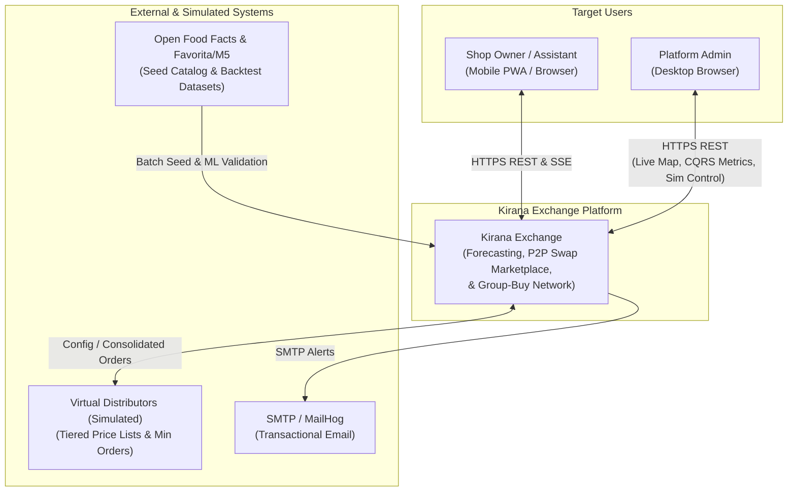
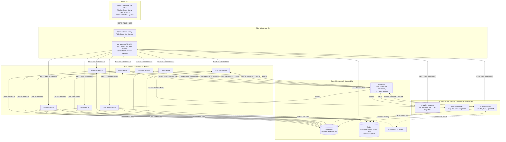
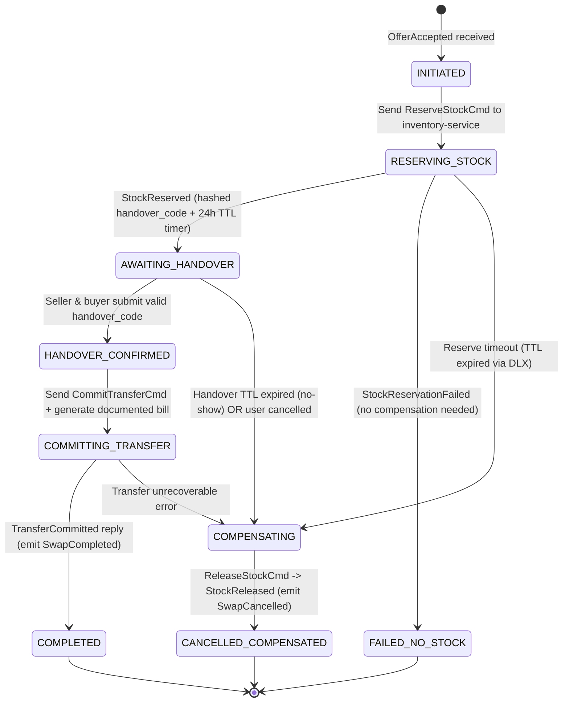
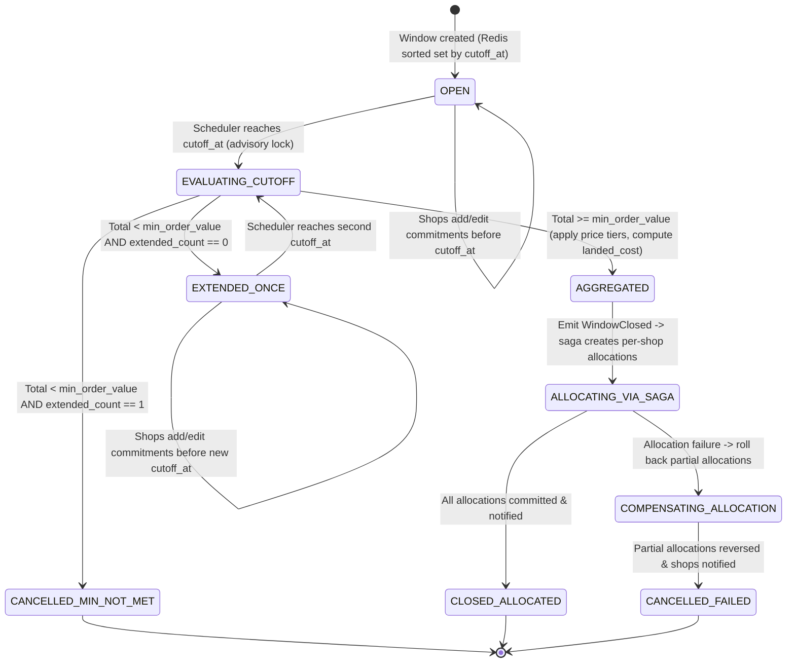
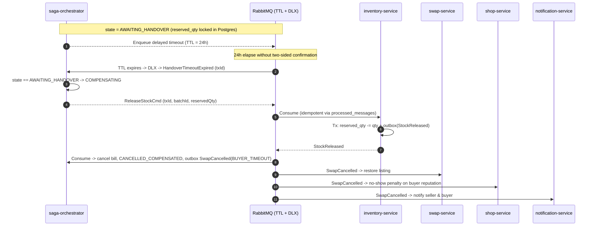

# Phase 1: Architecture, Service Boundaries, Events, State Machines & ADRs

## 1. Service Boundaries & Data Ownership

TypeScript/NestJS services live under `apps/`; Python ML/simulator services live under `services-py/`; shared NestJS utilities live in `libs/common/`; OpenAPI & JSON Schemas live in `libs/contracts/`; Docker/Nginx/Prometheus/Grafana configs live in `infra/`.

Every stateful service exclusively owns its PostgreSQL database/schema with **zero cross-service foreign keys or cross-service SQL reads**:

| Service                              | Single-Sentence Responsibility                                                                                        | Owned PostgreSQL Schema & Tables                                                                                         | Owned Redis Namespaces                                                 |
| :----------------------------------- | :-------------------------------------------------------------------------------------------------------------------- | :----------------------------------------------------------------------------------------------------------------------- | :--------------------------------------------------------------------- |
| **`api-gateway`**                    | Validates JWTs, enforces layered rate limits, injects `X-Correlation-Id`, and routes external HTTP/SSE requests.      | None (stateless proxy)                                                                                                   | `rl:*` (rate-limit buckets), reads `auth:denylist:*`                   |
| **`auth-service`**                   | Authenticates users, enforces RBAC and login lockouts, and rotates hashed refresh tokens.                             | `auth_db`: `users`, `refresh_tokens`, `audit_logs`                                                                       | `auth:denylist:*`, `auth:lockout:*`                                    |
| **`shop-service`**                   | Manages shop profiles, geospatial coordinates, GST schemes, reputation scores, and swap disputes.                     | `shop_db`: `shops`, `disputes`, `outbox_events`, `processed_messages`, `audit_logs`                                      | None (emits geo events via outbox)                                     |
| **`catalog-service`**                | Maintains the barcode-normalised master product catalog and serves `<100 ms` EAN and trigram searches.                | `catalog_db`: `products`, `outbox_events`, `audit_logs`                                                                  | `catalog:product:*`, `catalog:search:*` (cache-aside)                  |
| **`inventory-service`**              | Tracks shop stock batches, expiry dates, atomic stock reservations, and sales events as source of truth.              | `inventory_db`: `inventory_batches`, `sales_events`, `outbox_events`, `processed_messages`, `audit_logs`                 | `lock:batch:*` (fast-path `SET NX PX`), `idem:inventory:*`             |
| **`forecast-service`**               | Maintains an independent sales read model to compute weekly demand forecasts, safety-stock reorders, and risk flags.  | `forecast_db`: `sales_history_read_model`, `forecasts`, `batch_risk_flags`, `processed_messages`                         | `forecast:shop:*` (cached predictions with TTL)                        |
| **`swap-service`** (+ Python worker) | Manages surplus listings, shortage requests, rule-based price suggestions, and `scipy` geospatial candidate matching. | `swap_db`: `swap_listings`, `shortage_requests`, `swap_offers`, `outbox_events`, `processed_messages`                    | `geo:shops` (`GEOADD`/`GEOSEARCH`), `surplus:product:*`, `idem:swap:*` |
| **`saga-orchestrator`**              | Persists and executes multi-step state machines, timeouts, handover code checks, and compensations.                   | `saga_db`: `swap_transactions`, `swap_events`, `outbox_events`, `processed_messages`, `audit_logs`                       | `sse:swap:*` (Pub/Sub live status stream)                              |
| **`groupbuy-service`**               | Schedules distributor buying windows, collects commitments, computes tiered landed costs, and triggers allocations.   | `groupbuy_db`: `groupbuy_windows`, `groupbuy_commitments`, `groupbuy_allocations`, `outbox_events`, `processed_messages` | `gb:windows:cutoff` (sorted set), `idem:gb:*`                          |
| **`notification-service`**           | Consumes domain events to deliver in-app SSE and SMTP email alerts while enforcing daily caps and batching.           | `notify_db`: `notifications`, `processed_messages`                                                                       | `notify:cap:*`, `notify:batch:*`, `sse:notify:*`                       |
| **`analytics-simulator`**            | Generates seeded synthetic datasets, runs with/without-Exchange experiments, and serves CQRS admin projections.       | `analytics_db`: `network_metrics_projection`, `shop_map_projection`, `simulation_runs`, `processed_messages`             | None                                                                   |
| **`web-app`**                        | Renders the offline-capable React PWA for shopkeepers and live analytics dashboard for platform admins.               | Browser IndexedDB: `offline_mutation_queue`, `catalog_cache`                                                             | None                                                                   |

---

## 2. Domain Event Catalogue v1 (`kirana.events` Topic Exchange)

Every domain event has one producing service, is committed via the transactional outbox, and uses the canonical envelope:
`{ "id", "type", "version", "occurredAt", "correlationId", "producer", "payload" }`

| Event Type                   | Routing Key                         | Single Producer     | Consumers & Actions                                                                                                               | Key Payload Fields                                                                                                 |
| :--------------------------- | :---------------------------------- | :------------------ | :-------------------------------------------------------------------------------------------------------------------------------- | :----------------------------------------------------------------------------------------------------------------- |
| **`ShopCreated`**            | `shop.created.v1`                   | `shop-service`      | `swap-service` (Redis `GEOADD`), `analytics-simulator` (map projection)                                                           | `shopId`, `lat`, `lng`, `state`, `gstScheme`                                                                       |
| **`ShopMoved`**              | `shop.moved.v1`                     | `shop-service`      | `swap-service` (updates Redis `GEOADD`), `analytics-simulator` (map pin)                                                          | `shopId`, `lat`, `lng`, `state`                                                                                    |
| **`StockUpdated`**           | `inventory.stock.updated.v1`        | `inventory-service` | `forecast-service` (re-evaluates `days_of_cover`), `analytics-simulator`                                                          | `batchId`, `shopId`, `productId`, `qty`, `reservedQty`, `costPrice`, `expiryDate`                                  |
| **`SaleRecorded`**           | `inventory.sale.recorded.v1`        | `inventory-service` | `forecast-service` (appends to sales read model), `analytics-simulator`                                                           | `saleId`, `shopId`, `productId`, `batchId`, `qty`, `soldAt`, `stockoutFlag`                                        |
| **`BatchAtRisk`**            | `forecast.batch.at_risk.v1`         | `forecast-service`  | `swap-service` (listing draft prompt), `notification-service` (alerts owner), `analytics-simulator`                               | `batchId`, `shopId`, `productId`, `daysOfCover`, `riskType` (`DEAD_STOCK\|EXPIRY`), `suggestedAction`              |
| **`ShortageDetected`**       | `forecast.shortage.detected.v1`     | `forecast-service`  | `swap-service` (creates/updates shortage request), `notification-service`                                                         | `shopId`, `productId`, `week`, `expectedQty`, `reorderQty`, `safetyStock`                                          |
| **`ListingCreated`**         | `swap.listing.created.v1`           | `swap-service`      | `swap-service` Python worker (triggers geo + `scipy` match), `analytics-simulator`                                                | `listingId`, `shopId`, `batchId`, `productId`, `qty`, `suggestedPrice`, `price`, `expiresAt`, `state`              |
| **`MatchFound`**             | `swap.match.found.v1`               | `swap-service`      | `notification-service` (sends anonymised match alert to candidate buyer)                                                          | `listingId`, `candidateShopIds`, `productId`, `distanceKm`, `rankScore`, `offeredPrice`                            |
| **`OfferAccepted`**          | `swap.offer.accepted.v1`            | `swap-service`      | `saga-orchestrator` (starts swap saga transaction), `notification-service`                                                        | `offerId`, `listingId`, `sellerShopId`, `buyerShopId`, `batchId`, `productId`, `qty`, `agreedPrice`                |
| **`StockReserved`**          | `inventory.stock.reserved.v1`       | `inventory-service` | `saga-orchestrator` (advances saga to `AWAITING_HANDOVER` & generates hashed `handover_code`)                                     | `transactionId`, `batchId`, `shopId`, `reservedQty`, `newBatchVersion`                                             |
| **`StockReservationFailed`** | `inventory.stock.reserve_failed.v1` | `inventory-service` | `saga-orchestrator` (aborts saga -> `FAILED`, notifies buyer/seller)                                                              | `transactionId`, `batchId`, `reason` (`INSUFFICIENT_QTY\|VERSION_CONFLICT`)                                        |
| **`HandoverConfirmed`**      | `saga.handover.confirmed.v1`        | `saga-orchestrator` | `inventory-service` (commits stock transfer from seller batch to new buyer batch)                                                 | `transactionId`, `sellerShopId`, `buyerShopId`, `batchId`, `productId`, `qty`, `costPrice`, `expiryDate`           |
| **`SwapCompleted`**          | `saga.swap.completed.v1`            | `saga-orchestrator` | `shop-service` (+reputation), `swap-service` (closes listing), `notification-service`, `analytics-simulator`                      | `transactionId`, `listingId`, `sellerShopId`, `buyerShopId`, `qty`, `price`, `billRecordId`                        |
| **`SwapCancelled`**          | `saga.swap.cancelled.v1`            | `saga-orchestrator` | `shop-service` (-reputation on timeout/no-show), `swap-service` (restores listing), `notification-service`, `analytics-simulator` | `transactionId`, `listingId`, `sellerShopId`, `buyerShopId`, `reason` (`BUYER_TIMEOUT\|USER_CANCEL\|COMPENSATION`) |
| **`StockReleased`**          | `inventory.stock.released.v1`       | `inventory-service` | `saga-orchestrator` (confirms compensation finished and marks saga terminal)                                                      | `transactionId`, `batchId`, `releasedQty`, `newBatchVersion`                                                       |
| **`WindowClosed`**           | `groupbuy.window.closed.v1`         | `groupbuy-service`  | `saga-orchestrator` (executes per-shop allocation saga), `notification-service`, `analytics-simulator`                            | `windowId`, `distributorId`, `totalValue`, `outcome` (`ALLOCATING\|EXTENDED\|CANCELLED`), `allocations[]`          |

---

## 3. C4 Context & Container Diagrams

### 3.1 Level 1: System Context



### 3.2 Level 2: Containers



---

## 4. State Machines

### 4.1 Swap Saga (`saga-orchestrator`)

The saga state is persisted in `saga_db.swap_transactions`, with an append-only audit trail in `saga_db.swap_events`.



> **Schema alignment needed (Phase 9):** the `swap_transactions.state` CHECK in the [Phase 2 DDL](sql/01-schemas.sql) allows `FAILED` but not `FAILED_NO_STOCK` or `COMPENSATING`. Reconcile the two in the saga-orchestrator migration.

| State                 | Trigger / command                                                                                                          | Timeout (RabbitMQ TTL + DLX)           | Compensation on failure / timeout                                                                                                                                  |
| --------------------- | -------------------------------------------------------------------------------------------------------------------------- | -------------------------------------- | ------------------------------------------------------------------------------------------------------------------------------------------------------------------ |
| `INITIATED`           | `OfferAccepted` consumed                                                                                                   | Immediate dispatch                     | None (no stock locked yet)                                                                                                                                         |
| `RESERVING_STOCK`     | Publishes `ReserveStockCmd` to inventory-service                                                                           | **30 s**                               | Publish `ReleaseStockCmd` (idempotent; safe even if the reserve never landed), then go to `CANCELLED_COMPENSATED`                                                  |
| `AWAITING_HANDOVER`   | `StockReserved` received; hashed `handover_code` and bill record generated                                                 | **24 h** (configurable per simulation) | `ReleaseStockCmd` to decrement `reserved_qty`, cancel the bill record, restore listing availability, and apply a no-show reputation penalty if the buyer timed out |
| `HANDOVER_CONFIRMED`  | Seller and buyer confirm `handover_code`                                                                                   | **60 s**                               | Retry `CommitTransferCmd` with exponential backoff. If it is poisoned to the DLQ, alert an admin and hold the reservation until resolved                           |
| `COMMITTING_TRANSFER` | Seller batch decremented (`qty` and `reserved_qty`); buyer batch created with the preserved `cost_price` and `expiry_date` | **60 s**                               | Idempotent commit keyed by `transaction_id`; emits `SwapCompleted` on completion                                                                                   |

### 4.2 Group-Buy Window & Allocation (`groupbuy-service` + `saga-orchestrator`)

Window closure is guarded by a **PostgreSQL advisory lock** (`pg_try_advisory_xact_lock`) plus an atomic `WHERE status = 'OPEN'` status-transition check. This means running several scheduler instances still closes each window **exactly once**.



---

## 5. Cross-Cutting Rules & Protocols

### 5.1 Standard Error Format (RFC 9457)

Every NestJS and FastAPI service uses a global exception filter that returns `Content-Type: application/problem+json`:

```json
{
  "type": "https://kirana-exchange.local/errors/insufficient-unreserved-stock",
  "title": "Insufficient Unreserved Stock",
  "status": 409,
  "detail": "Batch b7f2... has only 4 unreserved units available, but 10 were requested.",
  "instance": "/v1/inventory/batches/b7f2/reserve",
  "correlationId": "9c81f42a-11d0-4b3e-9a62-0242ac120004",
  "errors": [{ "field": "qty", "code": "MAX_AVAILABLE_EXCEEDED", "available": 4 }]
}
```

The slug after `/errors/` must match [error-catalogue.md](error-catalogue.md).

### 5.2 Correlation IDs & Distributed Tracing

- **Header:** `X-Correlation-Id`.
- **Lifecycle:**
  - The api-gateway reuses an incoming ID or generates a UUIDv4.
  - Every synchronous REST call forwards it.
  - Every outbox event embeds it as `correlationId`.
  - Every Pino or Python JSON log line includes it.

### 5.3 Idempotency Protocol

- **Header:** `Idempotency-Key: <UUIDv4>` is mandatory on all state-mutating POST/PUT/PATCH endpoints: offline sales and stock sync, offer creation and acceptance, swap confirmation, and group-buy commitments.
- **Two-tier enforcement:**
  1. **Fast path (Redis):** `SET idem:<service>:<shopId>:<key> "IN_PROGRESS" NX EX 86400`. If a cached terminal response exists, return it without re-running business logic.
  2. **Source of truth (PostgreSQL):** write tables (`sales_events`, `swap_offers`, `swap_transactions`, `groupbuy_commitments`, and so on) enforce `UNIQUE (shop_id, idempotency_key)`, so even a full Redis flush cannot duplicate a sale or order.

### 5.4 Asynchronous Event Envelope

```json
{
  "id": "4e82a109-6c44-4f19-8a7e-99210b3a812c",
  "type": "OfferAccepted",
  "version": 1,
  "occurredAt": "2026-11-13T11:36:00.000Z",
  "correlationId": "9c81f42a-11d0-4b3e-9a62-0242ac120004",
  "producer": "swap-service",
  "payload": {
    "offerId": "...",
    "listingId": "...",
    "sellerShopId": "...",
    "buyerShopId": "...",
    "batchId": "...",
    "productId": "...",
    "qty": 12,
    "agreedPrice": 42.5
  }
}
```

Schema: [libs/contracts/events/envelope.schema.json](../libs/contracts/events/envelope.schema.json).

### 5.5 Retry, Backoff & DLQ Topology

- **Exchanges:** `kirana.events` (durable topic), `kirana.saga.commands` (direct), `kirana.dlx` (dead-letter).
- **Consumer idempotency:**
  - Delivery is at-least-once.
  - Every consumer runs in a local transaction that first inserts `(message_id, consumer_name, processed_at)` into `processed_messages` with `ON CONFLICT DO NOTHING`.
  - If zero rows are inserted, the message is ACKed and ignored.
- **Retry policy:**
  - Transient failures route to `<queue>.retry` via `kirana.dlx` with backoff delays: attempt 1 = 5 s, attempt 2 = 30 s, attempt 3 = 300 s.
  - After 3 failed attempts the message goes permanently to `<queue>.dlq`. That increments `rabbitmq_dlq_messages_total` and fires a Grafana alert, and the Phase 11 DLQ tool can inspect and replay it.

---

## 6. Architecture Decision Records

### ADR-001: RabbitMQ over Kafka for asynchronous messaging and sagas

- **Context:** services need reliable event broadcasting, command/reply queues for the swap saga, delayed step timeouts, and dead-letter queues.
- **Decision:** use RabbitMQ with topic exchanges, durable per-consumer queues, TTL-based delayed retry/timeout queues, and dead-letter exchanges.
- **Consequences:**
  - RabbitMQ natively supports TTLs, dead-letter routing for saga timeouts, and light operations on a single Compose VM.
  - Kafka's log compaction and partition rebalancing add operational weight our volume does not justify.
  - The outbox keeps a future broker switch possible without changing business logic.

### ADR-002: Database-per-service in PostgreSQL with strict schema ownership

- **Context:** microservices must be independently deployable without coupling through shared tables.
- **Decision:**
  - Each stateful service owns an isolated logical database inside one PostgreSQL instance (local/VM deployment).
  - There are **zero cross-service foreign keys or cross-service SQL queries**.
- **Consequences:**
  - Services communicate only via REST or domain events.
  - Services that need foreign data (forecast sales history, analytics metrics) maintain their own event-driven CQRS read models.

### ADR-003: Transactional outbox for reliable event publishing

- **Context:** dual-writing to PostgreSQL and RabbitMQ in a handler loses events if the broker drops after COMMIT.
- **Decision:**
  - Write state changes and an `outbox_events` row in the **same local transaction**.
  - A background relay polls unpublished rows (`FOR UPDATE SKIP LOCKED`), publishes them with **publisher confirms**, and marks them published.
- **Consequences:**
  - **At-least-once delivery**, even if the relay or RabbitMQ crashes mid-batch.
  - Consumers must be idempotent via `processed_messages`.

### ADR-004: PostgreSQL as source of truth for stock, Redis as fast-path lock

- **Context:** high-contention claims (for example 1,000 concurrent claims on 30 units) need low latency. A Redis eviction or restart must never cause negative stock or double-allocation.
- **Decision:**
  - PostgreSQL is the **sole authoritative guard**: `version` column + `CHECK (qty >= 0 AND reserved_qty >= 0 AND reserved_qty <= qty)`.
  - Every claim is a single conditional atomic `UPDATE ... SET reserved_qty = reserved_qty + :claim, version = version + 1 WHERE id = :id AND version = :v AND (qty - reserved_qty) >= :claim`.
  - Redis `SET NX PX` locks are only an optional fast-path filter.
- **Consequences:** if Redis fails, the system skips the fast path, and PostgreSQL still guarantees zero double-allocation.

### ADR-005: Synchronous REST for queries and simple commands; async events for cross-service change

- **Context:** the platform mixes immediate user-facing reads/writes with multi-service workflows (sagas, forecasting, notifications).
- **Decision:** use synchronous REST (OpenAPI 3.1) through the api-gateway for queries and single-service mutations, and RabbitMQ events/commands for cross-service propagation and multi-step sagas.
- **Consequences:**
  - Client reads stay simple and typed.
  - Slow or multi-step processes are decoupled, so one service failure never takes down the user-facing app.

---

## 7. Scenario Walkthroughs

### Scenario 1: Happy-path swap

```mermaid
sequenceDiagram
    autonumber
    participant Buyer as Buyer Shop (PWA)
    participant Seller as Seller Shop (PWA)
    participant Swap as swap-service
    participant RMQ as RabbitMQ
    participant Saga as saga-orchestrator
    participant Inv as inventory-service
    participant Shop as shop-service
    Buyer->>Swap: POST /v1/swaps/offers/{id}/accept (Idempotency-Key)
    Swap->>Swap: Tx: offer=ACCEPTED + outbox(OfferAccepted)
    Swap-->>RMQ: Publish OfferAccepted
    RMQ->>Saga: Consume (Tx: INITIATED -> RESERVING_STOCK)
    Saga-->>RMQ: ReserveStockCmd (batchId, qty)
    RMQ->>Inv: Consume ReserveStockCmd
    Inv->>Inv: Redis SET NX PX -> PG conditional UPDATE reserved_qty += qty
    Inv-->>RMQ: StockReserved (via outbox)
    RMQ->>Saga: Consume (Tx: AWAITING_HANDOVER, store handover_code_hash, start 24h TTL)
    Saga-->>Buyer: SSE "Stock reserved - collect & confirm code"
    Saga-->>Seller: SSE "Swap reserved - handover code ready"
    Seller->>Saga: POST /v1/sagas/{txId}/confirm-handover (code)
    Buyer->>Saga: POST /v1/sagas/{txId}/confirm-handover (code)
    Saga->>Saga: Both confirmed -> HANDOVER_CONFIRMED -> COMMITTING_TRANSFER
    Saga-->>RMQ: CommitTransferCmd (sellerBatchId, buyerShopId, qty, cost, expiry)
    RMQ->>Inv: Consume CommitTransferCmd
    Inv->>Inv: Tx: seller qty & reserved_qty -= qty; create buyer batch (same cost & expiry)
    Inv-->>RMQ: TransferCommitted
    RMQ->>Saga: Consume (Tx: generate bill, COMPLETED, outbox SwapCompleted)
    Saga-->>RMQ: SwapCompleted
    RMQ->>Shop: Consume SwapCompleted (+reputation_score)
```

### Scenario 2: Buyer no-show timeout and automatic compensation



### Scenario 3: Two buyers claim the same units concurrently

The batch has `qty = 10`, `reserved_qty = 0`, `version = 4`. Two sagas (T1 and T2) each request 10 units at the same millisecond:

1. T1 acquires `SET lock:batch:55 T1 NX PX 2000`. T2's lock attempt fails, so T2 backs off briefly or falls through to the DB guard.
2. T1 runs `UPDATE ... SET reserved_qty = reserved_qty + 10, version = 5 WHERE id = 55 AND version = 4 AND (qty - reserved_qty) >= 10`. One row is updated and `StockReserved(T1)` is written to the outbox. T1 releases the lock with an owner-checked Lua CAS.
3. T2's identical `UPDATE` matches **0 rows**, because the version changed and no unreserved stock remains. Inventory writes `StockReservationFailed(T2, INSUFFICIENT_QTY)`, and T2 moves to `FAILED_NO_STOCK`.

### Scenario 4: Crash immediately after reserving stock

```mermaid
sequenceDiagram
    autonumber
    participant Saga as saga-orchestrator
    participant RMQ as RabbitMQ
    participant Inv as inventory-service
    participant PG as PostgreSQL (inventory_db)
    participant Relay as Outbox Relay
    Saga-->>RMQ: ReserveStockCmd (txId=T9, batchId=88, qty=5)
    RMQ->>Inv: Deliver (unacked)
    Inv->>PG: BEGIN; INSERT processed_messages; UPDATE reserved_qty += 5; INSERT outbox(StockReserved); COMMIT
    Note over Inv: CRASH before ACK and before relay runs
    par Recovery A: redelivery
        RMQ->>Inv: Redeliver ReserveStockCmd after restart
        Inv->>PG: INSERT processed_messages ON CONFLICT DO NOTHING -> 0 rows
        Inv-->>RMQ: ACK (zero duplicate reservation)
    and Recovery B: outbox relay
        Relay->>PG: SELECT unpublished FOR UPDATE SKIP LOCKED
        Relay-->>RMQ: Publish StockReserved with publisher confirm
        Relay->>PG: UPDATE outbox_events SET published_at = NOW()
    end
    RMQ->>Saga: StockReserved(T9) -> AWAITING_HANDOVER (or compensate if T9 already timed out)
```

---

## 8. Phase 1 Verification Checklist ("Done When")

- Each scenario traces step by step through the diagrams with no undefined state (all 4 sequence diagrams and both state machines).
- Every event has exactly one producing service (§2).
- Every service fits a one-sentence responsibility (§1).
