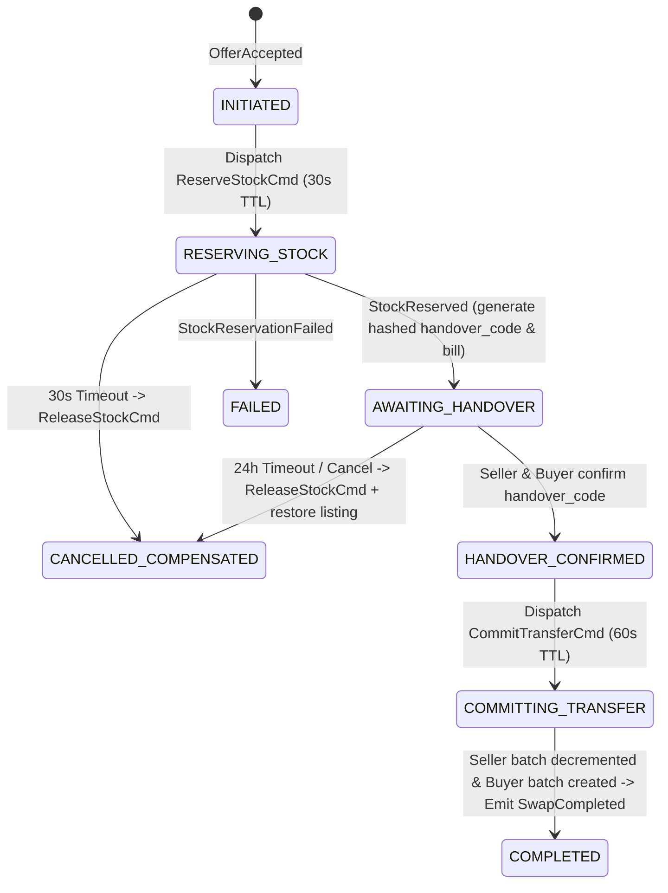

# Phase 1: Architecture, Service Boundaries, Events, State Machines & ADRs

## 1. Service Boundaries & Data Ownership

TypeScript/NestJS services live under `apps/`; Python ML/simulator services live under `services-py/`; shared NestJS utilities live in `libs/common/`; OpenAPI & JSON Schemas live in `libs/contracts/`; Docker/Nginx/Prometheus/Grafana configs live in `infra/`.

Every stateful service exclusively owns its PostgreSQL database/schema with **zero cross-service foreign keys or cross-service SQL reads**:

| Service                              | Single-Sentence Responsibility                                                                                        | Owned PostgreSQL Schema & Tables                                                                                         | Owned Redis Namespaces                                                 |
| :----------------------------------- | :-------------------------------------------------------------------------------------------------------------------- | :----------------------------------------------------------------------------------------------------------------------- | :--------------------------------------------------------------------- |
| **`api-gateway`**                    | Validates JWTs, enforces layered rate limits, injects `X-Correlation-Id`, and routes external HTTP/SSE requests.      | None (stateless proxy)                                                                                                   | `rl:*` (rate-limit buckets), reads `auth:denylist:*`                   |
| **`auth-service`**                   | Authenticates users, enforces RBAC and login lockouts, and rotates hashed refresh tokens.                             | `auth_db`: `users`, `refresh_tokens`, `audit_logs`                                                                       | `auth:denylist:*`, `auth:lockout:*`                                    |
| **`shop-service`**                   | Manages shop profiles, geospatial coordinates, GST schemes, reputation scores, and swap disputes.                     | `shop_db`: `shops`, `disputes`, `outbox_events`, `processed_messages`, `audit_logs`                                      | None (emits geo events via outbox)                                     |
| **`catalog-service`**                | Maintains the barcode-normalised master product catalog and serves `<100 ms` EAN and trigram searches.                | `catalog_db`: `products`, `outbox_events`, `audit_logs`                                                                  | `catalog:product:*`, `catalog:search:*` (cache-aside)                  |
| **`inventory-service`**              | Tracks shop stock batches, expiry dates, atomic stock reservations, and sales events as source of truth.              | `inventory_db`: `inventory_batches`, `sales_events`, `outbox_events`, `processed_messages`, `audit_logs`                 | `lock:batch:*` (fast-path `SET NX PX`), `idem:inventory:*`             |
| **`forecast-service`**               | Maintains an independent sales read model to compute weekly demand forecasts, safety-stock reorders, and risk flags.  | `forecast_db`: `sales_history_read_model`, `forecasts`, `batch_risk_flags`, `processed_messages`                         | `forecast:shop:*` (cached predictions with TTL)                        |
| **`swap-service`** (+ Python worker) | Manages surplus listings, shortage requests, rule-based price suggestions, and `scipy` geospatial candidate matching. | `swap_db`: `swap_listings`, `shortage_requests`, `swap_offers`, `outbox_events`, `processed_messages`                    | `geo:shops` (`GEOADD`/`GEOSEARCH`), `surplus:product:*`, `idem:swap:*` |
| **`saga-orchestrator`**              | Persists and executes multi-step state machines, timeouts, handover code checks, and compensations.                   | `saga_db`: `swap_transactions`, `swap_events`, `outbox_events`, `processed_messages`, `audit_logs`                       | `sse:swap:*` (Pub/Sub live status stream)                              |
| **`groupbuy-service`**               | Schedules distributor buying windows, collects commitments, computes tiered landed costs, and triggers allocations.   | `groupbuy_db`: `groupbuy_windows`, `groupbuy_commitments`, `groupbuy_allocations`, `outbox_events`, `processed_messages` | `gb:windows:cutoff` (sorted set), `idem:gb:*`                          |
| **`notification-service`**           | Consumes domain events to deliver in-app SSE and SMTP email alerts while enforcing daily caps and batching.           | `notify_db`: `notifications`, `processed_messages`                                                                       | `notify:cap:*`, `notify:batch:*`, `sse:notify:*`                       |
| **`analytics-simulator`**            | Generates seeded synthetic datasets, runs with/without-Exchange experiments, and serves CQRS admin projections.       | `analytics_db`: `network_metrics_projection`, `shop_map_projection`, `simulation_runs`, `processed_messages`             | None                                                                   |
| **`web-app`**                        | Renders the offline-capable React PWA for shopkeepers and live analytics dashboard for platform admins.               | Browser IndexedDB: `offline_mutation_queue`, `catalog_cache`                                                             | None                                                                   |

---

## 2. Domain Event Catalogue v1 (`kirana.events` Topic Exchange)

Every domain event has one producing service, is committed via the transactional outbox, and uses the canonical envelope:
`{ "id", "type", "version", "occurredAt", "correlationId", "producer", "payload" }`

| Event Type                   | Routing Key                         | Single Producer     | Consumers & Actions                                                                                                               | Key Payload Fields                                                                                                 |
| :--------------------------- | :---------------------------------- | :------------------ | :-------------------------------------------------------------------------------------------------------------------------------- | :----------------------------------------------------------------------------------------------------------------- |
| **`ShopCreated`**            | `shop.created.v1`                   | `shop-service`      | `swap-service` (Redis `GEOADD`), `analytics-simulator` (map projection)                                                           | `shopId`, `lat`, `lng`, `state`, `gstScheme`                                                                       |
| **`ShopMoved`**              | `shop.moved.v1`                     | `shop-service`      | `swap-service` (updates Redis `GEOADD`), `analytics-simulator` (map pin)                                                          | `shopId`, `lat`, `lng`, `state`                                                                                    |
| **`StockUpdated`**           | `inventory.stock.updated.v1`        | `inventory-service` | `forecast-service` (re-evaluates `days_of_cover`), `analytics-simulator`                                                          | `batchId`, `shopId`, `productId`, `qty`, `reservedQty`, `costPrice`, `expiryDate`                                  |
| **`SaleRecorded`**           | `inventory.sale.recorded.v1`        | `inventory-service` | `forecast-service` (appends to sales read model), `analytics-simulator`                                                           | `saleId`, `shopId`, `productId`, `batchId`, `qty`, `soldAt`, `stockoutFlag`                                        |
| **`BatchAtRisk`**            | `forecast.batch.at_risk.v1`         | `forecast-service`  | `swap-service` (listing draft prompt), `notification-service` (alerts owner), `analytics-simulator`                               | `batchId`, `shopId`, `productId`, `daysOfCover`, `riskType` (`DEAD_STOCK\|EXPIRY`), `suggestedAction`              |
| **`ShortageDetected`**       | `forecast.shortage.detected.v1`     | `forecast-service`  | `swap-service` (creates/updates shortage request), `notification-service`                                                         | `shopId`, `productId`, `week`, `expectedQty`, `reorderQty`, `safetyStock`                                          |
| **`ListingCreated`**         | `swap.listing.created.v1`           | `swap-service`      | `swap-service` Python worker (triggers geo + `scipy` match), `analytics-simulator`                                                | `listingId`, `shopId`, `batchId`, `productId`, `qty`, `suggestedPrice`, `price`, `expiresAt`, `state`              |
| **`MatchFound`**             | `swap.match.found.v1`               | `swap-service`      | `notification-service` (sends anonymised match alert to candidate buyer)                                                          | `listingId`, `candidateShopIds`, `productId`, `distanceKm`, `rankScore`, `offeredPrice`                            |
| **`OfferAccepted`**          | `swap.offer.accepted.v1`            | `swap-service`      | `saga-orchestrator` (starts swap saga transaction), `notification-service`                                                        | `offerId`, `listingId`, `sellerShopId`, `buyerShopId`, `batchId`, `productId`, `qty`, `agreedPrice`                |
| **`StockReserved`**          | `inventory.stock.reserved.v1`       | `inventory-service` | `saga-orchestrator` (advances saga to `AWAITING_HANDOVER` & generates hashed `handover_code`)                                     | `transactionId`, `batchId`, `shopId`, `reservedQty`, `newBatchVersion`                                             |
| **`StockReservationFailed`** | `inventory.stock.reserve_failed.v1` | `inventory-service` | `saga-orchestrator` (aborts saga -> `FAILED`, notifies buyer/seller)                                                              | `transactionId`, `batchId`, `reason` (`INSUFFICIENT_QTY\|VERSION_CONFLICT`)                                        |
| **`HandoverConfirmed`**      | `saga.handover.confirmed.v1`        | `saga-orchestrator` | `inventory-service` (commits stock transfer from seller batch to new buyer batch)                                                 | `transactionId`, `sellerShopId`, `buyerShopId`, `batchId`, `productId`, `qty`, `costPrice`, `expiryDate`           |
| **`SwapCompleted`**          | `saga.swap.completed.v1`            | `saga-orchestrator` | `shop-service` (+reputation), `swap-service` (closes listing), `notification-service`, `analytics-simulator`                      | `transactionId`, `listingId`, `sellerShopId`, `buyerShopId`, `qty`, `price`, `billRecordId`                        |
| **`SwapCancelled`**          | `saga.swap.cancelled.v1`            | `saga-orchestrator` | `shop-service` (-reputation on timeout/no-show), `swap-service` (restores listing), `notification-service`, `analytics-simulator` | `transactionId`, `listingId`, `sellerShopId`, `buyerShopId`, `reason` (`BUYER_TIMEOUT\|USER_CANCEL\|COMPENSATION`) |
| **`StockReleased`**          | `inventory.stock.released.v1`       | `inventory-service` | `saga-orchestrator` (confirms compensation finished and marks saga terminal)                                                      | `transactionId`, `batchId`, `releasedQty`, `newBatchVersion`                                                       |
| **`WindowClosed`**           | `groupbuy.window.closed.v1`         | `groupbuy-service`  | `saga-orchestrator` (executes per-shop allocation saga), `notification-service`, `analytics-simulator`                            | `windowId`, `distributorId`, `totalValue`, `outcome` (`ALLOCATING\|EXTENDED\|CANCELLED`), `allocations[]`          |

---

## 3. Swap Saga & Group-Buy State Machines

### 3.1 Swap Saga State Machine (`saga-orchestrator`)

Persisted in `saga_db.swap_transactions` with append-only audit steps in `saga_db.swap_events`:

