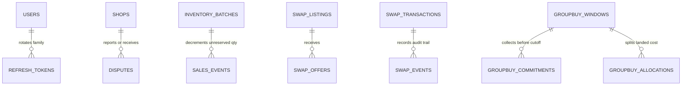

# Phase 2 Data Model

## Database ownership

Each stateful service owns its tables in an isolated PostgreSQL database. The reference DDL is [01-schemas.sql](sql/01-schemas.sql). There are no cross-service foreign keys; identifiers for records owned by another service are opaque UUIDs.

## Shared persistence patterns

- Mutating services write domain changes and `outbox_events` in the same local transaction.
- The relay polls `outbox_events` with `FOR UPDATE SKIP LOCKED`; `idx_outbox_unpublished` keeps unpublished rows efficient to find.
- Consumers insert `(message_id, consumer_name)` into `processed_messages` with `ON CONFLICT DO NOTHING` before applying business logic.
- State-mutating tables enforce `(shop_id, idempotency_key)` uniqueness where applicable.
- Sensitive actions and saga steps are recorded in append-only `audit_logs` or `swap_events`.

## Service-isolated entity-relationship diagram

## Query-to-index justification matrix

| UI screen or worker             | Database            | Index                             | Query pattern                      | Latency target |
| ------------------------------- | ------------------- | --------------------------------- | ---------------------------------- | -------------- |
| Barcode and product search      | `catalog_db`        | `idx_products_name_trgm`          | Trigram `ILIKE` on active products | Under 100 ms   |
| Inventory and near-expiry table | `inventory_db`      | `idx_batches_shop_expiry`         | Shop batches ordered by expiry     | Under 500 ms   |
| Weekly order and clear lists    | `forecast_db`       | `idx_forecasts_shop_week`         | Latest weekly forecast per shop    | Under 200 ms   |
| Nearby surplus marketplace      | `swap_db`           | `idx_listings_state_product_open` | Open listings in the same state    | Under 300 ms   |
| Offer inbox and counter flows   | `swap_db`           | `idx_offers_seller_pending`       | Pending offers for seller shop     | Under 500 ms   |
| Live swap tracker and handovers | `saga_db`           | `idx_swap_tx_shops`               | Active saga state for a shop       | Under 500 ms   |
| Group-buy windows and tiers     | `groupbuy_db`       | `idx_gb_windows_cutoff`           | Open windows sorted by cutoff      | Under 500 ms   |
| Notification drawer             | `notify_db`         | `idx_notifications_shop_sent`     | Recent shop alerts, newest first   | Under 500 ms   |
| Outbox relay worker             | All event producers | `idx_outbox_unpublished`          | Unpublished events, oldest first   | No lost events |
